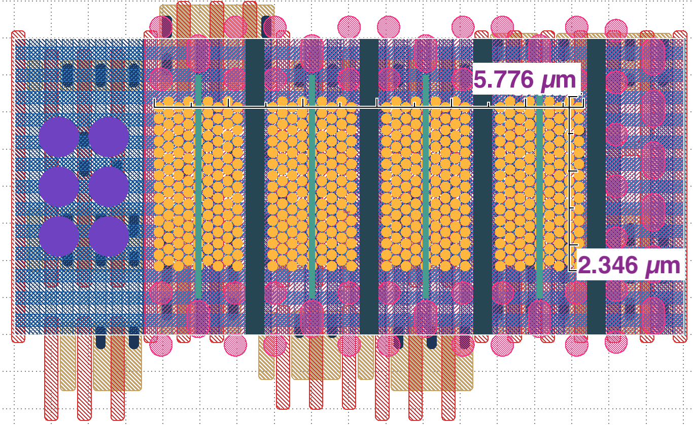
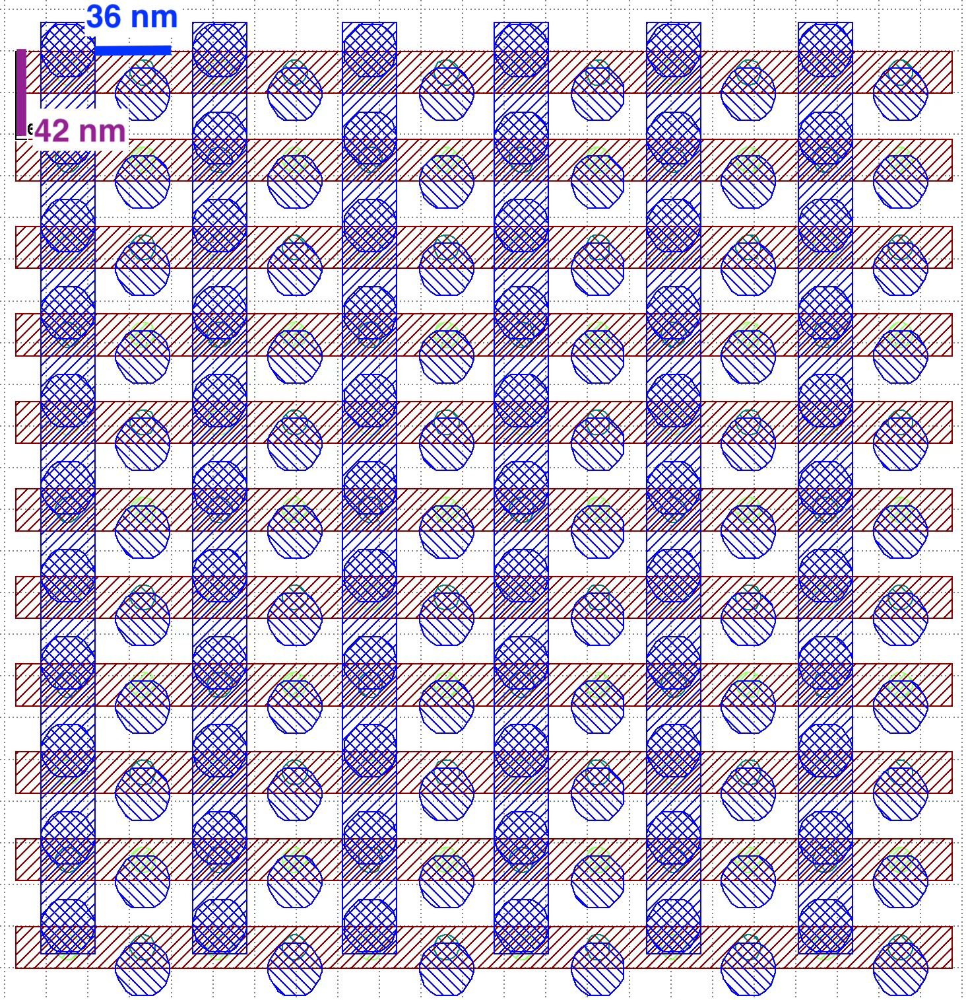
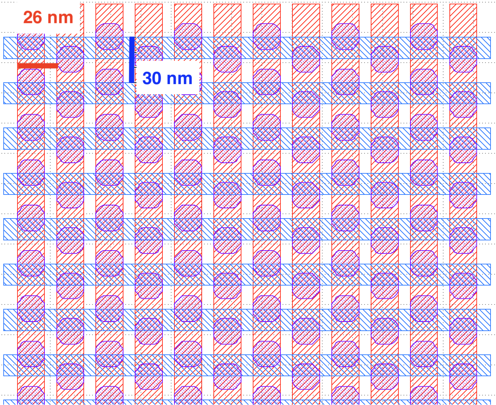
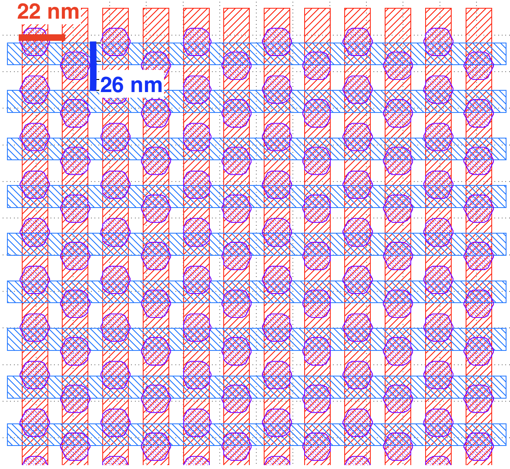
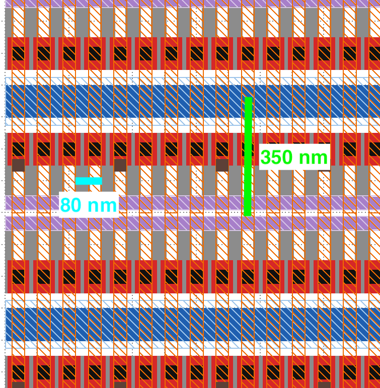
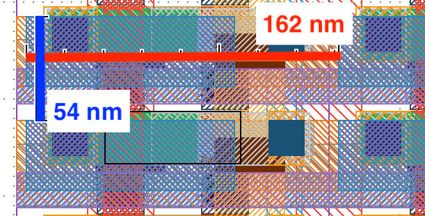

# Embodied Carbon per Bit

## 3D NAND Flash

Die area for all flash chips was fixed to 50 sq mm, making 1130 good die per 300 mm wafer at 90% chip yield. Memory array density was calculated for each stack height within the array (area labeled on GDS below). Cembodied per bit was calculated after applying a fill factor between 61-66% to account for non-array die area (e.g., peripheral circuits).

| 3D NAND Flash GDS |  |  |  |
| :---- | :---- | :---- | ----- |
| **Configuration** | **Array Density** | **Fill Factor** | **Embodied/Gb (kg CO2e/Gb)** |
| **32L** | 3.4 | 0.6176865978 | 0.002055892609 |
| **176L** | 18.7 | 0.6591912309 | 0.0006674290293 |
| **512L** | 54.3 | 0.6652439899 | 0.0004416815971 |
| **1024L** | 108.6 | 0.6668292363 | 0.0003817396872 |

<table>
  <tr>
    <td align="center"> <em>3D NAND Flash</em></td>
  </tr>
</table>

## DRAM

Die area for all DRAM chips was fixed to 100 sq mm, making 562 good die per 300 mm wafer at 90% chip yield. Memory array density was calculated for the BG, VG, and IGZO configurations using the number of wordline/bitline crossings in the array (area labeled on GDS images below). For 3D DRAM, memory array density was calculated from stack height (64 layers) and x/y capacitor density (labeled on GDS below). Cembodied per bit was calculated after applying a fill factor between 48-84% to account for non-array die area (e.g., peripheral circuits).

| DRAM GDS |  |  |  |  |
| :---- | :---- | :---- | :---- | :---- |
| **Configuration** | **Array Density** | **Fill Factor** | **Wordline pitch** | **Bitline pitch** |
| **BG1** | 0.6613756614 | 0.48384 | 36 | 42 |
| **BG2** | 0.754147813 | 0.57018 | 34 | 39 |
| **VG1** | 1.282051282 | 0.624 | 26 | 30 |
| **VG2/3** | 1.748251748 | 0.88 | 22 | 26 |
| **3D1/2** | 2.285714286 | 0.8413461538 | 80 | 350 |
| **IGZO** | 0.4572473708 | 0.69984 | 54 | 162 |

<table>
  <tr>
    <td align="center"> <em>BG1</em></td>
    <td align="center"> <em>VG1</em></td>
    <td align="center"> <em>VG2/3</em></td>
    <td align="center"> <em>3D1/2</em></td>
    <td align="center"> <em>IGZO</em></td>
  </tr>
</table>

