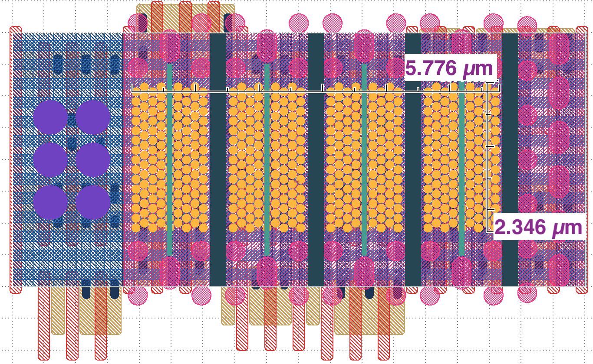
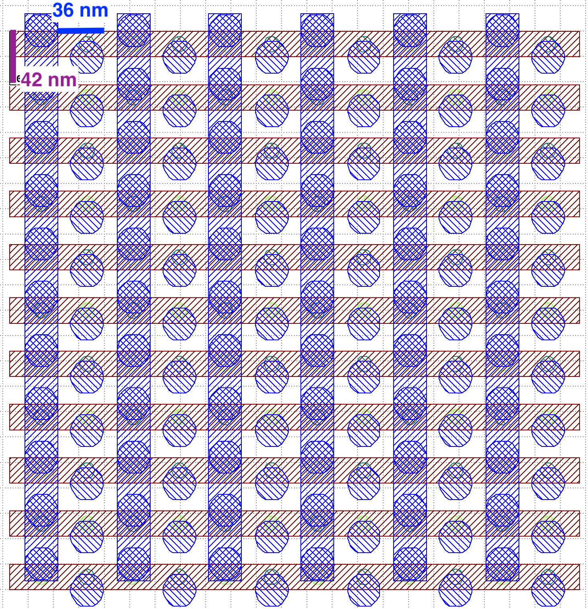
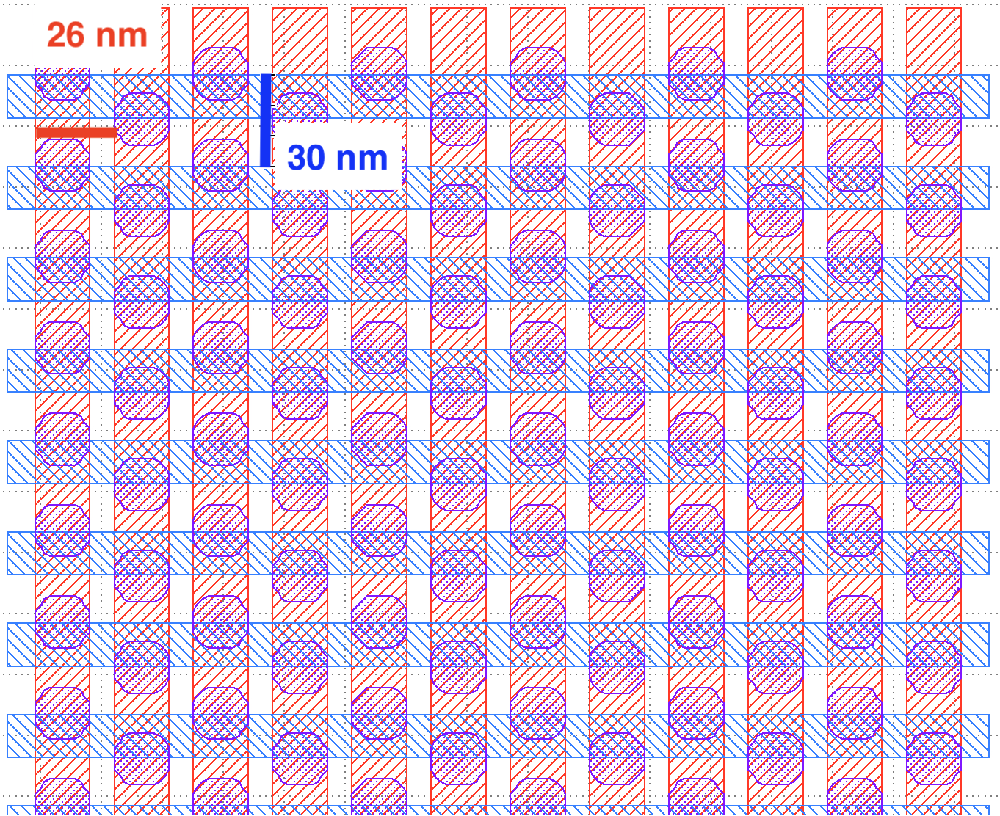
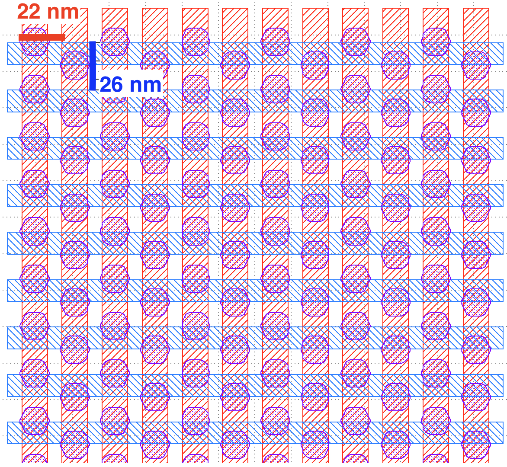
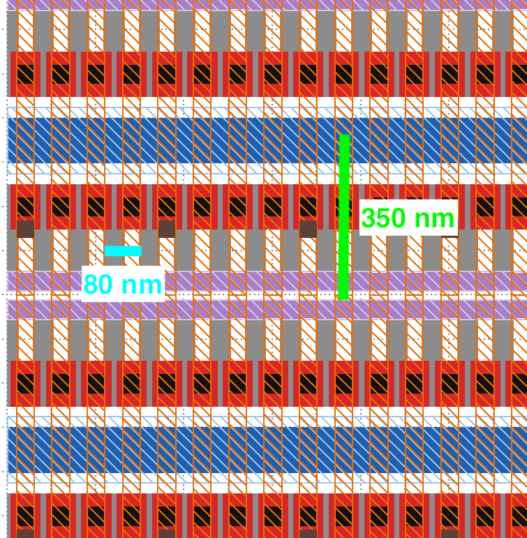
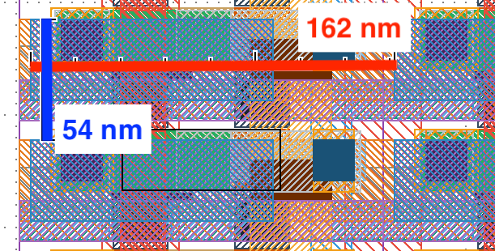

# Embodied Carbon per Bit

## 3D NAND Flash

Die area for all flash chips was fixed to 50 sq mm, making 1130 good die per 300 mm wafer at 90% chip yield. Memory array density was calculated for each stack height within the array (area labeled on GDS below). Cembodied per bit was calculated after applying a fill factor between 37-40% to account for non-array die area (e.g., peripheral circuits).

| 3D NAND Flash GDS |  |  |  |
| :---- | :---- | :---- | ----- |
| **Configuration** | **Array Density (Gb per sq mm)** | **Fill Factor (%)** | **Embodied/Gb (kg CO2e/Gb)** |
| **32L** | 5.0 | 37.1953125 | 0.004752430157 |
| **48L** | 7.5 | 38.21354167 | 0.003345441717 |
| **64L** | 10.0 | 38.72265625 | 0.002780235961 |
| **92L** | 14.4 | 39.1875 | 0.002114475302 |
| **128L** | 20.0 | 39.48632813 | 0.001743231272 |
| **176L** | 27.5 | 39.69460227 | 0.001456788645 |
| **236L** | 36.9 | 39.83580508 | 0.001251836978 |
| **336L** | 52.6 | 39.95907738 | 0.001083010069 |
| **512L** | 80.1 | 40.05908203 | 0.0009422051386 |
| **640L** | 100.2 | 40.09726563 | 0.0008900753362 |
| **768L** | 120.2 | 40.12272135 | 0.0008549360305 |
| **896L** | 140.2 | 40.14090402 | 0.000829849727 |
| **1024L** | 160.3 | 40.15454102 | 0.0008083705908 |

<table>
  <tr>
    <td align="center"> <em>3D NAND Flash</em></td>
  </tr>
</table>

## DRAM

Die area for all DRAM chips was fixed to 100 sq mm, making 562 good die per 300 mm wafer at 90% chip yield. Memory array density was calculated for the BG, VG, and IGZO configurations using the number of wordline/bitline crossings in the array (area labeled on GDS images below). For 3D DRAM, memory array density was calculated from stack height (64 layers) and x/y capacitor density (labeled on GDS below). Cembodied per bit was calculated after applying a fill factor between 48-88% to account for non-array die area (e.g., peripheral circuits).

| DRAM GDS |  |  |  |  |
| :---- | :---- | :---- | :---- | :---- |
| **Configuration** | **Array Density (Gb per sq mm)** | **Fill Factor (%)** | **Wordline pitch (nm)** | **Bitline pitch (nm)** |
| **BG1** | 0.6613756614 | 48.384 | 36 | 42 |
| **BG2** | 0.754147813 | 57.018 | 34 | 39 |
| **VG1** | 1.282051282 | 62.4 | 26 | 30 |
| **VG2/3** | 1.748251748 | 88 | 22 | 26 |
| **3D1/2** | 2.285714286 | 84.13461538 | 80 | 350 |
| **IGZO** | 0.4572473708 | 69.984 | 54 | 162 |

<table>
  <tr>
    <td align="center"> <em>BG1</em></td>
    <td align="center"> <em>VG1</em></td>
    <td align="center"> <em>VG2/3</em></td>
    <td align="center"> <em>3D1/2</em></td>
    <td align="center"> <em>IGZO</em></td>
  </tr>
</table>

